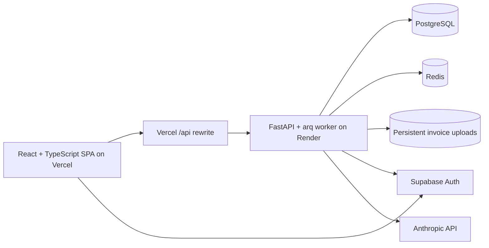

# FinPilot

FinPilot is a multi-tenant financial operations app for small businesses. It turns invoices and bank transactions into organized records, cash-flow reports, budgets, and reviewable AI assistance.

## What it does

- Tracks company transactions, categories, budgets, invoices, and team roles.
- Imports bank CSV files with row-level results and duplicate protection.
- Extracts invoice fields and suggests transaction categories through constrained AI workflows. People can review uncertain results.
- Produces deterministic cash-flow, runway, budget-versus-actual, and anomaly calculations. AI may select a supported financial question or phrase an explanation, but it does not calculate figures or write financial records.
- Shows weekly digests and optional private email delivery.

## Project status

The backend and main product screens are implemented. Deployment configuration is prepared for Vercel (web app) and Render (API, worker, PostgreSQL, Redis, and persistent invoice uploads), but live cloud resources have not been provisioned from this checkout. See [deployment steps](docs/DEPLOYMENT.md).

The current checkout uses Supabase Auth. Older architecture notes still describe the previous API-issued JWT flow, and the current auth path needs a real Supabase sign-in smoke test before the project can be called complete. The interview-assessment MCP work remains separate and is not part of FinPilot's release scope.

## Architecture



The local Docker Compose stack keeps PostgreSQL, Redis, API, worker, and uploaded files together. In the initial hosted setup, the API and arq worker share one Render service and persistent disk so the existing local-file worker handoff remains intact. That service is intentionally single-instance; moving to separate API/worker services requires shared object storage.

## Local setup

Prerequisites: Python 3.13, [uv](https://docs.astral.sh/uv/), Node.js 22, npm, and Docker Compose.

1. Create `.env` from `.env.example` only if `.env` does not already exist. Add your Supabase URL and anon key, Anthropic API key, and a secret key. Do not replace an existing `.env` file.
2. Set `DATABASE_URL` in `.env` to the local PostgreSQL database shown in `docker-compose.yml`, using the `postgresql+asyncpg` driver.
3. Start the local services:

   ```powershell
   docker compose up -d --build
   ```

4. For a new, empty local database, review the pending Alembic files, confirm `DATABASE_URL` points only to that local development database, then apply the schema and seed global categories:

   ```powershell
   uv run alembic upgrade head
   uv run python -m app.scripts.seed_categories
   ```

   Never run migrations against `finpilot_test` manually: the backend test fixture owns it, applies migrations, and clears its tables. Do not point migration commands at a database containing records you want to keep.

5. Create `frontend/.env.local` from `frontend/.env.example` if needed and set the same Supabase project values. Then start the web app:

   ```powershell
   cd frontend
   npm ci
   npm run dev
   ```

6. Open [http://localhost:5173](http://localhost:5173). Vite proxies `/api` to the local FastAPI API on port 8000. The API health endpoint is [http://localhost:8000/health](http://localhost:8000/health); interactive API docs are at [http://localhost:8000/docs](http://localhost:8000/docs).

If you only need automated backend tests, the test fixture safely creates/uses `finpilot_test` and upgrades it to the latest migration. Do not run the app against the test database while tests are executing.

## Test and acceptance process

See [the full testing and metrics guide](docs/TESTING_GUIDE.md) for automated commands, real-stack checks, role and tenant-isolation scenarios, an exact sample ledger with expected dashboard figures, AI checks, and labeled categorization evaluation.

Quick automated checks:

```powershell
uv run pytest --ignore=tests/mcp -q
cd frontend
npm run test -- --maxWorkers=1
npm run typecheck
npm run lint
npm run build
```

The MCP assessment tests are excluded from the FinPilot product suite. Automated tests mock Anthropic; the separate categorization evaluation command makes metered real API requests.

## Deployment

1. Review [docs/DEPLOYMENT.md](docs/DEPLOYMENT.md), especially the cloud cost and migration gates.
2. Create the Render resources from `render.yaml`, set its secret values, and complete the reviewed schema setup.
3. Set Vercel's project root to `frontend`, then set `FINPILOT_API_ORIGIN` to the Render API origin and configure the two public Supabase build variables.
4. Copy the resulting Vercel URL back to Render's `APP_PUBLIC_URL` and the Supabase Auth redirect allow-list.
5. Follow the deployed smoke test in [docs/TESTING_GUIDE.md](docs/TESTING_GUIDE.md).

## Project and resume copy

See [docs/PROJECT_PROFILE.md](docs/PROJECT_PROFILE.md) for short and long project descriptions and resume-ready bullets. The profile labels the hosting as a target until the actual URL is live.
